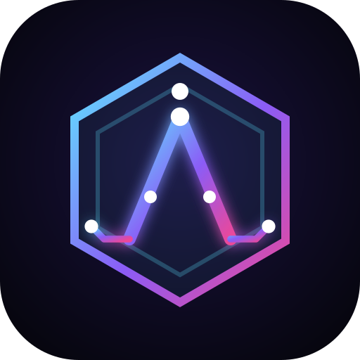

<p align="center"></p>

<h1 align="center">ALAI</h1>
<p align="center">Deine KI zum Schreiben, Telefonieren und Dateien teilen – mit eigenem Gehirn.</p>

## Was ALAI kann

- **Chatten** mit Live-Antworten (Markdown, Code, Tabellen) und Websuche für aktuelle Infos
- **Anrufen**: Sprachanruf-Modus, du redest, ALAI hört zu und antwortet mit Stimme (Tippen auf die Kugel unterbricht)
- **Diktieren**: Mikro-Button im Eingabefeld
- **Anhänge**: Bilder, PDFs und Textdateien per Büroklammer, Drag & Drop oder Einfügen. ALAI schickt dir auch Dateien zurück (Download-Karte)
- **Profile**: Jedes Profil hat seine eigene Datenbank auf dem Gerät, die erst nach Zustimmung angelegt wird
- **Memories**: ALAI merkt sich wichtige Fakten, Vorlieben, Ziele, Personen und Ereignisse
- **Gehirn**: 3D-Hologramm aller Memories, drehbar und zoombar, mit Suche, Filter, Löschen, Selbst-Eintragen und Export
- **Als App installierbar** (PWA): im Browser „Zum Home-Bildschirm hinzufügen“

## Live stellen (Vercel, kostenlos)

1. API-Key holen: [console.anthropic.com/settings/keys](https://console.anthropic.com/settings/keys) (braucht Guthaben)
2. Auf [vercel.com/new](https://vercel.com/new) mit GitHub anmelden und dieses Repo importieren
3. Bei **Environment Variables** eintragen:
   - `ANTHROPIC_API_KEY` = dein Key
   - `ALAI_ACCESS_CODE` = ein Passwort deiner Wahl (empfohlen, sonst kann jeder mit dem Link dein Guthaben nutzen)
4. **Deploy** drücken. Fertig.

## Lokal starten

```bash
npm install
cp .env.example .env.local   # Key eintragen
npm run dev                  # http://localhost:3000
```

## Gut zu wissen

- Sprache (Anrufen/Diktieren) läuft über den Browser: am besten Chrome, Edge oder Safari. Firefox kann keine Spracherkennung.
- Chats und Memories liegen nur im Browser des Geräts (IndexedDB, eine Datenbank pro Profil). Anderes Gerät = eigenes Gehirn.
- Anhänge: max. 3 MB pro Datei, große Bilder werden automatisch verkleinert.

## Technik

Next.js 16 · React 19 · Claude API (`claude-opus-5-5`) · Three.js · Web Speech API · IndexedDB
